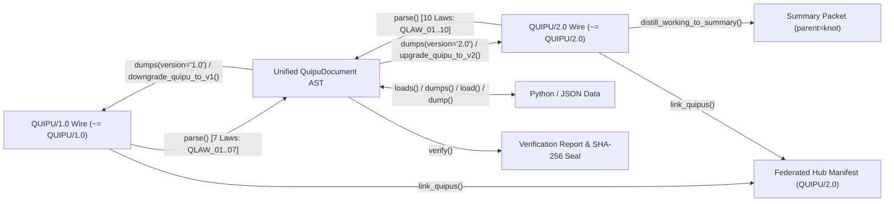

# quipu

[](https://www.python.org/downloads/)
[](https://opensource.org/licenses/MIT)
[-10b981.svg)](#installation)
[](https://github.com/astral-sh/ruff)
[](https://mypy-lang.org/)

> **Standalone `QUIPU/2.0` & `QUIPU/1.0` (`.quipu`) Data, Columnar Arithmetic & Cryptographic Provenance Standard**  
> Zero-dependency, JSON-isomorphic serialization format combining human-ergonomic configs, zero-key-repetition typed tables, inline double-entry verification, taint/mutability metadata, and built-in SHA-256 tamper seals.

---

## Purpose & Target Use Cases

JSON, YAML, and TOML each solve a narrow slice of structured data exchange while leaving four recurring engineering gaps open:

1. **Ergonomic Configuration Without Parser Hazards**: JSON forbids `#` comments and trailing commas; YAML 1.2 suffers from implicit type coercion (`yes`/`no` -> bool) and exponential alias-bomb DoS (`CWE-776`). `.quipu` supports `#` comments, bare keys, trailing commas, and headerless `lax` mode while remaining **100% losslessly isomorphic to JSON**.
2. **AI / LLM Structured State & Tool I/O**: Uniform record lists waste tokens repeating identical keys in JSON. `@table(...)` compiles uniform records into typed columnar grids (distinguishing `bool` from `int`), enforces working-window ceilings (`MAX_WORKING_ROWS = 1000`), and attaches provenance trust tiers (`@T0..@T3`) to prevent prompt/data poisoning.
3. **Zero-Key-Repetition Typed Telemetry**: Banded `@table` blocks support row spacers (`---`), sub-slice sums (`^sum(col, start, end)`), and compact bit-register fingerprints (`encode_7bit`, `encode_14bit`, `render_quipu_micro`) for $O(1)$ routing and telemetry inspection.
4. **Double-Entry & Tolerance-Guarded Financial / Resource Ledgers**: Inline upward assertions (`^count`, `^sum`, `^net`, `^equal_sum`, `^tol`, `^band`, `^quota`) verify conservation laws, budget tolerances, and cohort quotas statically before application logic executes.
5. **Tamper-Evident Signed Lockfiles & Multi-Agent Handoffs**: `mode=sealed` enforces a deterministic SHA-256 content seal (`=~ knot="quipu-<12hex>"`), tracks cryptographic `parent` lineage across `working -> summary` distillation, and federates mixed `1.0`/`2.0` packets under `hub` manifests via `link_quipus()`.

---

## Format Comparison

| Capability | **QUIPU/2.0 (`.quipu`)** | **JSON** | **JSONC / JSON5** | **YAML 1.2** | **TOML 1.0** | **CSV / TSV** | **XML** |
| :--- | :---: | :---: | :---: | :---: | :---: | :---: | :---: |
| **Comments (`# ...`)** | Yes | No | Yes (`//`, `/* */`) | Yes | Yes | No | Yes (`<!-- -->`) |
| **Lossless JSON Bijection** | **100%** | Native | Partial (NaN/hex) | Ambiguous (`yes`/`no`) | Partial (dates/tables) | Flat only | Lossy (attrs vs elems) |
| **Typed Columnar `@table`** | **Built-in (`bool != int`)** | No | No | No | Verbose `[[array]]` | Untyped | Verbose |
| **Inline Arithmetic & Double-Entry** | **`^count`, `^sum`, `^net`, `^tol`, `^band`, `^quota`** | No | No | No | No | No | External XSD/Schematron |
| **Built-in SHA-256 Content Seal (`=~`)** | **Built-in (`quipu-<12hex>`)** | External JWS | External | External | External | External | XML-DSig (complex) |
| **Safe Bounded Aliases** | **Bounded DAG (`<= 1024`)** | No | No | Unsafe (billion-laughs risk) | No | No | XXE / Entity risk |
| **Mutability & Data-Trust Tiers** | **`~Z`/`~S`, `~R`/`~V`, `@T0..@T3`, `@W`/`@D`** | No | No | Custom tags (untyped) | No | No | Custom attributes |
| **Hierarchical Distillation & Hub Linking** | **Built-in (`tier`, `parent`, `hub`)** | No | No | No | No | No | Manual |
| **Zero-Dependency Footprint** | **Yes (0 deps, pure stdlib)** | Yes | Needs parser | Needs PyYAML/ruamel | Write needs `tomli-w` | Flat only | Expat/lxml risk |

---

## Architecture



---

## Primitives Summary (What & Why)

Every QUIPU decorator, directive, and register strips cleanly during `loads()`/`load()` so standard JSON consumers receive plain Python dicts, lists, and scalars, while validators and agents get machine-checkable guarantees in-band:

| Primitive | Syntax & AST Field | What It Is & Why It Is Needed |
| :--- | :--- | :--- |
| **Spin / Mutability** | `~Z` / `~S` (`CordMeta.spin`) | Immutable canonical SSOT (`~Z`) vs mutable runtime/override (`~S`). Prevents accidental policy or config mutation inside locked containers (`QLAW_05`). |
| **Branch Attachment** | `~R` / `~V` (`CordMeta.attachment`) | Primary active branch (`~R`) vs shadow/canary/verification branch (`~V`). Co-locates live and canary/audit twins atomically without brittle `"foo_shadow"` keys. |
| **Trust Tiers** | `@T0`..`@T3` (`CordMeta.tier`) | Provenance trust hierarchy from `T0` (verified SSOT) to `T3` (untrusted user/network input). Enforces taint non-escalation (`QLAW_06`) so trusted nodes cannot alias untrusted anchors. |
| **Accounting Polarity** | `@W` / `@D` (`CordMeta.polarity`) | Asset/credit/budget (`@W`) vs obligation/debt/charge (`@D`). Makes financial, token-budget, and quota cords self-describing for double-entry auditing without external schemas. |
| **Physical / Semantic Unit** | `^unit="..."` (`CordMeta.unit`) | Explicit unit annotation (`"usd"`, `"ms"`, `"bytes"`, `"tokens"`). Prevents unit-mismatch bugs (ms vs seconds, cents vs dollars) without boxing decoded numbers. |
| **Protocol / Wrapper Tag** | `^wrap="..."` (`CordMeta.wrap`) | Codec or compliance wrapper tag (`"hmac_sha256"`, `"base64"`, `"semver"`, `"pii_redacted"`). Carries encoding provenance out-of-band without wrapper objects. |
| **Auxiliary Checksum Weight** | `^nether=<num>` (`CordMeta.nether`) | Secondary numeric epoch, fee weight, or reconciliation delta attached to a node. Transports audit metadata without altering the decoded scalar value. |
| **Base-10 Knots & `1E`** | `^knots="0M-0C-4D-1E"` (`CordMeta.knots`) | Positional decimal parity (`M-C-D-U`) plus `1E` figure-eight singular/sentinel marker (`encode_knots(..., figure_eight_unit=True)`). Catches silent integer corruption or LLM digit hallucinations (`QLAW_02`). |
| **Bounded DAG Reuse** | `&anchor` / `*alias` (`CordAlias`) | Acyclic node reuse capped at `<= 1024` expansions and `<= 10` chain depth (`QLAW_04`, `QLAW_09`). Eliminates repetition without YAML's billion-laughs DoS (`CWE-776`). |
| **Typed Tables & Top-Cords** | `@table(...)`, `---`, `^layout`, `^count`, `^sum`, `^net`, `^equal_sum`, `^tol`, `^band`, `^quota` | Columnar typed tables with row spacers (`---`), slice sums `^sum(col, s, e)`, double-entry `^net`/`^equal_sum`, overrun guard `^tol`, spacer ratio `^band`, and cohort projection `^quota` (`QLAW_03`, `QLAW_08`). |
| **Header Governance & Seal** | `~=`, `mode`, `tier`, `tag`, `parent`, `hub`, `=~` | Enforces `MAX_WORKING_ROWS = 1000` context bounds (`working` vs `summary` vs `hybrid`), cryptographic `parent` lineage, `hub` federation, and SHA-256 tamper evidence (`QLAW_01`, `QLAW_10`). |
| **Registers & Quantization** | `encode_7bit`, `encode_14bit`, `SCALE_BUCKETS`, `quantize_bucket`, `project_quota_population`, `render_quipu_micro` | Compact bit vectors, logarithmic scale buckets (`1..1000`), and single-line micro fingerprints for $O(1)$ routing, indexing, and capacity projection without full AST parsing. |

---

## Installation

`quipu` requires **Python 3.10+** and has **zero runtime dependencies**.

```bash
# Install directly from GitHub
pip install "git+https://github.com/skupriienko/quipu.git"

# Or clone and install in editable mode
git clone https://github.com/skupriienko/quipu.git
cd quipu
pip install -e .
```

---

## Quick Python API

```python
import io
import quipu

# 1. Lossless JSON / Python serialization & deserialization
payload = {
    "service": "edge-gateway",
    "metrics": [
        {"stage": "lint", "tokens": 42, "ok": True},
        {"stage": "test", "tokens": 118, "ok": True},
    ],
}
wire = quipu.dumps(payload, doc_id="ci.receipt", mode="sealed")
assert quipu.loads(wire) == payload

# 2. Stream I/O (mirrors json.dump / json.load)
buf = io.StringIO()
quipu.dump(payload, buf, doc_id="ci.receipt")
buf.seek(0)
assert quipu.load(buf) == payload

# 3. Parse into typed AST & run 10-law static verification
doc = quipu.parse(wire)
report = quipu.verify(wire)
assert report["valid"] is True
assert len(report["laws_checked"]) == 10  # 7 laws for QUIPU/1.0, 10 for QUIPU/2.0

# 4. Version compatibility, distillation & multi-packet federation
v1_doc = quipu.downgrade_quipu_to_v1(wire)
v2_doc = quipu.upgrade_quipu_to_v2(v1_doc, admin_tier="working", tag="ci")
summary_doc = quipu.distill_working_to_summary(v2_doc)
hub_doc = quipu.link_quipus({"legacy": v1_doc, "rollup": summary_doc}, hub_id="HubA")
```

---

## CLI Usage

```bash
# Print a canonical QUIPU/2.0 (or QUIPU/1.0) sample packet
quipu sample --format-version 2.0

# Verify all 10 static laws & SHA-256 seal (JSON report optional)
quipu verify --file examples/ledger_sealed.quipu --json

# Convert JSON <-> .quipu
quipu from-json --file data.json --mode sealed --format-version 2.0
quipu to-json --file examples/telemetry_banded.quipu

# Benchmark bytes and token savings vs JSON
quipu bench --file examples/telemetry_banded.quipu

# Emit compact 7-bit / 14-bit micro summary line
quipu micro --file examples/telemetry_banded.quipu

# Upgrade 1.0 -> 2.0, downgrade 2.0 -> 1.0, or distill working -> summary
quipu upgrade --file examples/legacy_v1.quipu --admin-tier working --tag release
quipu downgrade --file examples/telemetry_banded.quipu
quipu distill --file examples/telemetry_banded.quipu

# Start the zero-dependency Stdio JSON-RPC 2.0 MCP server
quipu mcp
```

---

## MCP Client Configuration

`quipu` includes a pure-stdlib Stdio JSON-RPC 2.0 MCP server (`quipu mcp`) exposing the `quipu_codec` tool (`verify`, `encode`, `decode`, `from_json`, `to_json`, `micro`, `benchmark`, `upgrade`, `downgrade`, `distill`).

Add the following to your MCP client configuration (Claude Desktop, Cursor, Windsurf, Kilo Code, etc.):

```json
{
  "mcpServers": {
    "quipu": {
      "command": "quipu",
      "args": ["mcp"]
    }
  }
}
```

---

## Andean Epigraphic Heritage

While all wire tokens and Python identifiers in `QUIPU/2.0` use concise English keywords, the data model is directly inspired by structural mechanisms documented in Andean *khipu* archives:

| Historical Term | Origin | Concise English Meaning | QUIPU Keyword / API |
| :--- | :--- | :--- | :--- |
| *khipu / quipu* | Quechua | Knotted-cord tactile accounting and archival record | `QUIPU/2.0`, `.quipu` |
| *kayte* | Quechua | Categorical label attached to the primary cord | `tag="..."` (`--tag`) |
| *canuto* | Spanish | Colored thread wrapping encoding source or codec provenance | `^wrap="..."` (`CordMeta.wrap`) |
| *inokatha / nakku* | Aymara / Quechua | Balanced double-entry check pairing credit and obligation cords | `^net(credit, debt)` |
| *yapa / qhincha* | Quechua | Permissible positive margin (*yapa*) vs overrun breach (*qhincha*) | `^tol(col, pct=N)` |
| *waranqa* | Quechua | Administrative unit of 1,000 capping working-record granularity | `MAX_WORKING_ROWS = 1000` |
| *yupana* | Quechua | Stepped counting board quantizing quantities into scale buckets | `SCALE_BUCKETS`, `quantize_bucket()` |
| *khipus enlazados* | Spanish | Companion khipus linked under one supervisory hub cord | `link_quipus(..., hub_id=...)` |
| *chakana* (spacer) | Quechua | Knotless spacing interval dividing banded cord groups | `---` spacer & `^band` |
| *hanan / hurin* (recto / verso) | Quechua | Dual paired structural attachment sides (primary vs shadow) | `~R` / `~V` (`CordAttachment`) |
| *Z / S spin* | Epigraphy | Directional fiber ply twist distinguishing canonical vs mutable cords | `~Z` / `~S` (`CordSpin`) |

---

## Documentation & Examples

- **Formal Specification**: [docs/SPECIFICATION.md](docs/SPECIFICATION.md) — EBNF grammar, lexical rules, canonical SHA-256 sealing, all 10 verification laws (`QLAW_01`..`QLAW_10`), CWE bounds, and full heritage glossary.
- **Cookbook & Patterns**: [docs/EXAMPLES.md](docs/EXAMPLES.md) — End-to-end recipes for configs, double-entry ledgers, banded telemetry, decorators, compatibility shims, CLI, and MCP JSON-RPC.
- **Runnable `.quipu` Fixtures**:
  - [examples/config_lax.quipu](examples/config_lax.quipu) — Ergonomic headerless config with comments
  - [examples/ledger_sealed.quipu](examples/ledger_sealed.quipu) — Sealed `QUIPU/2.0` double-entry ledger (`^net`, `^equal_sum`, `^tol`, `^band`, `^quota`, `---`)
  - [examples/telemetry_banded.quipu](examples/telemetry_banded.quipu) — Sealed `QUIPU/2.0` banded telemetry with decorators & `&`/`*` alias
  - [examples/legacy_v1.quipu](examples/legacy_v1.quipu) — Sealed `QUIPU/1.0` packet for backward-compatibility testing

---

## License

MIT © [Serhii Kupriienko](https://github.com/skupriienko)
